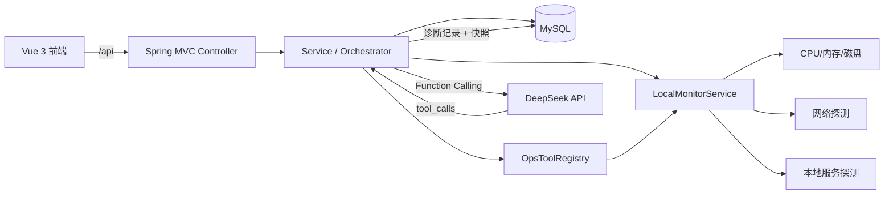

# AIOps Agent

智能运维与故障诊断演示平台：管理故障工单、实时监控本机运行状态、通过 DeepSeek Agent
调用本机运维工具进行诊断，并归档诊断记录。

> 监控数据来自后端所在机器的实时采集（CPU、内存、磁盘、网络、本地服务）。
> 诊断开始时会自动捕获一份本机快照，AI 与规则诊断都基于同一份快照分析。

## 功能

- 故障工单：创建、详情、状态流转、根因/解决方案记录、关键词与状态筛选、分页、删除。
- AI 故障诊断：DeepSeek Chat Completions + Function Calling，最多 5 轮工具调用。
- 规则诊断：不依赖大模型和 API Key，适合离线演示。
- 自动快照：从监控页诊断时捕获本机实时指标，工具调用复用同一份快照，结果中返回快照详情。
- 工单文本分析：从工单进入诊断时默认只分析描述文本，不读取本机指标；可手动切换数据来源。
- 诊断历史：每次诊断自动落库，可分页查询、查看工具调用明细和快照。
- 设备监控：实时采集本机 CPU、内存、磁盘、网络延迟、本地服务状态，前端每 3 秒刷新。
- 统一参数校验与 JSON 错误响应；API Key/数据库密码不写入源码。
- H2 测试环境，无需 MySQL 或真实 API Key 即可跑测试。

## 技术栈

| 层 | 技术 |
|---|---|
| 后端 | Java 17、Spring Boot 3.5.16、Spring Web、Bean Validation |
| 持久化 | MyBatis-Plus 3.5.12、MySQL 8、H2（测试） |
| AI | DeepSeek Chat Completions、Function Calling |
| 前端 | Vue 3.5、Vite 8、Axios |
| 测试 | JUnit 5、Spring Boot Test、MockMvc、MockRestServiceServer |

## 架构



## 目录结构

```text
aiops-agent/
├── agent/                 Spring Boot 后端
│   ├── src/main/java/com/aiops/agent/
│   │   ├── common/        统一响应、异常处理
│   │   ├── config/        DeepSeek、CORS 配置
│   │   ├── controller/    REST 接口
│   │   ├── domain/        状态/严重程度枚举
│   │   ├── dto/           请求与响应 DTO
│   │   ├── entity/        MyBatis-Plus 实体
│   │   ├── mapper/        Mapper
│   │   ├── service/       业务、本机监控、诊断编排、记录服务
│   │   └── tool/          工具注册表
│   └── src/test/          单元测试与集成测试
├── frontend/              Vue 3 + Vite 前端
├── scripts/               启动脚本（Java 17 检查）
├── sql/schema.sql         可重复执行的建库建表脚本
├── docs/api.md            接口文档
└── .env.example           环境变量示例
```

## 快速开始

### 1. 环境要求

- JDK 17
- MySQL 8（本地 3306 端口）
- Node.js `^20.19.0` 或 `>=22.12.0`、npm

### 2. 初始化数据库

```bash
mysql -u root -p < sql/schema.sql
```

PowerShell 不支持 `<` 重定向，可改用：

```powershell
Get-Content sql\schema.sql | mysql -u root -p
```

脚本会创建 `aiops_agent` 数据库和 `incidents`、`diagnosis_records` 两张表，
可重复执行，**不会清空已有数据**。

### 3. 本地配置

后端默认激活 `local` profile，从 classpath 的 `application-local.yml` 读取本地数据库密码和 Key。
实际文件位置是 `agent/src/main/resources/application-local.yml`，已被 `.gitignore` 忽略。
**如果该文件已存在，直接编辑即可；不存在时再从模板复制：**

```powershell
Copy-Item agent\src\main\resources\application-local.yml.example agent\src\main\resources\application-local.yml
```

```yaml
spring:
  datasource:
    username: root
    password: "你的MySQL密码"
deepseek:
  api-key: "sk-你的DeepSeek Key"
```

- DeepSeek Key 到 https://platform.deepseek.com/api_keys 创建。
- 不配置 `DEEPSEEK_API_KEY` 时，AI 诊断接口返回 503；规则诊断仍可用，前端会自动降级到规则诊断。
- 配置在 classpath 中，IDE、Maven、jar 从任意工作目录启动都能加载；IDE 把 Project SDK 设为 JDK 17 即可。
- 启动时会执行数据库连接检查；失败会输出明确的排查清单。
- 如果只用环境变量，可设置 `SPRING_PROFILES_ACTIVE=prod`，再配置 `DB_PASSWORD`、`DEEPSEEK_API_KEY`。
- 本地构建的 jar 会包含 `application-local.yml`，不要把这个 jar 分发给其他人。

PowerShell 环境变量方式：

```powershell
$env:SPRING_PROFILES_ACTIVE="prod"
$env:DB_USERNAME="root"
$env:DB_PASSWORD="你的数据库密码"
$env:DEEPSEEK_API_KEY="sk-你的Key"
```

Bash 环境变量方式：

```bash
export SPRING_PROFILES_ACTIVE=prod
export DB_USERNAME=root
export DB_PASSWORD='你的数据库密码'
export DEEPSEEK_API_KEY='sk-你的Key'
```

### 4. 启动后端

先确认 Java 版本。本机 PATH 里的 `java` 可能是 Java 8，直接 `java -jar` 会报
`UnsupportedClassVersionError`；项目需要 **Java 17+**。

```powershell
.\scripts\run-backend.cmd
```

脚本会检查 `JAVA_HOME` 并调用 Maven wrapper，避免系统 PATH 里的 Java 8。
如果 PowerShell 允许运行脚本，也可以执行 `.\scripts\run-backend.ps1`。也可以手动执行：

```powershell
.\agent\mvnw.cmd -f agent\pom.xml spring-boot:run
```

或：

```bash
cd agent
./mvnw spring-boot:run
```

后端地址：http://localhost:8080 ，健康检查：http://localhost:8080/api/health

### 5. 启动前端

```bash
cd frontend
npm install
npm run dev
```

打开 http://localhost:5173 。开发环境 `/api` 由 Vite 代理到 `http://localhost:8080`。

### 常见启动问题

| 现象 | 原因与处理 |
|---|---|
| `UnsupportedClassVersionError ... class file version 61.0` | 终端 `java` 是 Java 8。使用 `.\scripts\run-backend.cmd`，或把 `JAVA_HOME`/`PATH` 指向 JDK 17+ |
| `Access denied ... (using password: NO)` | 没加载本地配置。确认 `agent/src/main/resources/application-local.yml` 存在，推荐用启动脚本 |
| 前端 `请求失败 502` | 后端没有启动或 8080 不可达。先访问 http://localhost:8080/api/health |
| `Unknown database 'aiops_agent'` | 执行 `sql/schema.sql` |
| AI 诊断返回 503 | 没配置 `DEEPSEEK_API_KEY`，在本地配置或环境变量中填写后重启后端 |

## 环境变量

| 变量 | 默认值 | 说明 |
|---|---|---|
| `SERVER_PORT` | `8080` | 后端端口 |
| `SPRING_PROFILES_ACTIVE` | `local` | 默认加载 classpath 的 `application-local.yml`；只用环境变量时设为 `prod` |
| `DB_URL` | 本地 `aiops_agent` | JDBC URL |
| `DB_USERNAME` | `root` | 数据库用户名 |
| `DB_PASSWORD` | 空 | 数据库密码，可在本地 profile 或环境变量中设置 |
| `DB_CHECK_ON_STARTUP` | `true` | 启动时执行数据库连接检查 |
| `DEEPSEEK_BASE_URL` | `https://api.deepseek.com` | API 地址 |
| `DEEPSEEK_API_KEY` | 空 | DeepSeek Key，不写入仓库 |
| `DEEPSEEK_MODEL` | `deepseek-flash` | 模型名 |
| `DEEPSEEK_CONNECT_TIMEOUT` | `5s` | 连接超时 |
| `DEEPSEEK_READ_TIMEOUT` | `60s` | 读取超时 |
| `DEEPSEEK_MAX_TOOL_ROUNDS` | `5` | 最大工具调用轮次 |
| `MONITOR_NETWORK_HOST` | `www.baidu.com` | 网络连通性探测目标 |
| `MONITOR_NETWORK_PORT` | `443` | 网络探测端口 |
| `MONITOR_NETWORK_TIMEOUT_MS` | `1000` | 网络探测超时 |
| `MONITOR_SERVICE_NAME` | `MySQL` | 本地服务名称 |
| `MONITOR_SERVICE_HOST` | `127.0.0.1` | 本地服务地址 |
| `MONITOR_SERVICE_PORT` | `3306` | 本地服务端口 |
| `MONITOR_SERVICE_TIMEOUT_MS` | `500` | 服务探测超时 |
| `CORS_ALLOWED_ORIGINS` | `http://localhost:5173,http://127.0.0.1:5173` | 允许的前端来源，逗号分隔 |
| `VITE_API_BASE_URL` | `/api` | 前端 API 基础地址 |

完整示例见 [.env.example](.env.example)。

## 接口概览

完整请求/响应示例见 [docs/api.md](docs/api.md)。

| 方法 | 路径 | 说明 |
|---|---|---|
| GET | `/api/health` | 健康检查 |
| POST | `/api/incidents` | 创建工单（201） |
| GET | `/api/incidents` | 工单列表（兼容接口） |
| GET | `/api/incidents/{id}` | 工单详情 |
| GET | `/api/incidents/stats` | 工单统计 |
| GET | `/api/incidents/page` | 分页查询 |
| GET | `/api/incidents/search` | 关键词/状态/严重程度筛选分页 |
| PUT | `/api/incidents/{id}/status` | 更新状态 |
| PUT | `/api/incidents/{id}/resolution` | 保存根因/解决方案/状态 |
| DELETE | `/api/incidents/{id}` | 删除工单（204） |
| POST | `/api/diagnosis/agent` | AI 工具调用诊断并归档 |
| POST | `/api/diagnosis/rule` | 规则诊断并归档 |
| POST | `/api/diagnosis/run` | 兼容旧别名，等价于 rule |
| GET | `/api/diagnosis/records` | 诊断历史分页 |
| GET | `/api/diagnosis/records/{id}` | 诊断记录详情 |
| GET | `/api/monitor/local` | 本机实时监控快照 |
| GET | `/api/monitor/{deviceId}` | 兼容旧路径，返回同一份本机快照 |

统一错误结构：

```json
{
  "status": 400,
  "message": "工单标题不能为空",
  "timestamp": "2026-10-22T14:00:00Z",
  "path": "/api/incidents"
}
```

## 诊断流程

1. 前端提交设备标识与故障描述。
2. `DiagnosisOrchestrator` 在诊断开始时采集一份本机实时快照，并 pin 到当前线程。
3. AI 模式下 `DeepSeekAgentService` 把快照和三个工具定义一起发给 DeepSeek。
4. 模型返回 `tool_calls` 后，`OpsToolRegistry` 只允许执行白名单工具，且所有工具读取同一份 pin 住的快照。
5. 规则诊断直接使用这份快照生成结论，不调用大模型。
6. 结论、工具调用明细和快照写入 `diagnosis_records`，返回 `recordId`。
7. 若数据库保存失败，仍返回诊断结论，但 `recordId` 为 `null`，前端提示未归档。

诊断请求支持两种数据来源 `snapshotMode`：

- `LOCAL`：诊断开始时采集本机实时快照，工具返回本机指标。
- `TEXT`：不读取本机指标，只分析工单描述中的 CPU、内存、磁盘、延迟、服务状态等信息。
  从工单进入诊断页时默认使用该模式。

工具白名单：

- `check_system_metrics`
- `check_network`
- `check_service_status`

模型传入的 `deviceId` 会被强制覆盖为请求中的设备标识；未知工具不会执行。所有工具数据都来自后端所在机器，不会访问请求中指定的其他设备。

## 测试

后端测试使用 H2 内存数据库，不需要 MySQL 或 DeepSeek Key：

```powershell
.\agent\mvnw.cmd -f agent\pom.xml test
```

前端构建：

```bash
npm --prefix frontend run build
```

## 已知限制

- 未实现登录、权限与多租户。
- 监控只采集后端所在机器，不采集其他主机；网络/本地服务探测目标可通过 `MONITOR_*` 配置。
- 前端通过 3 秒轮询刷新，不是 WebSocket/SSE 推送；未接入 Prometheus、SSH 或分布式 Agent。
- 工单与诊断记录暂未通过外键关联；可从设备标识和描述关联。
- AI 诊断依赖外部 DeepSeek 服务，费用与可用性受上游影响。
- 旧版本曾在 `application.yml` 中写入真实 API Key；请在 DeepSeek 控制台轮换该 Key。
